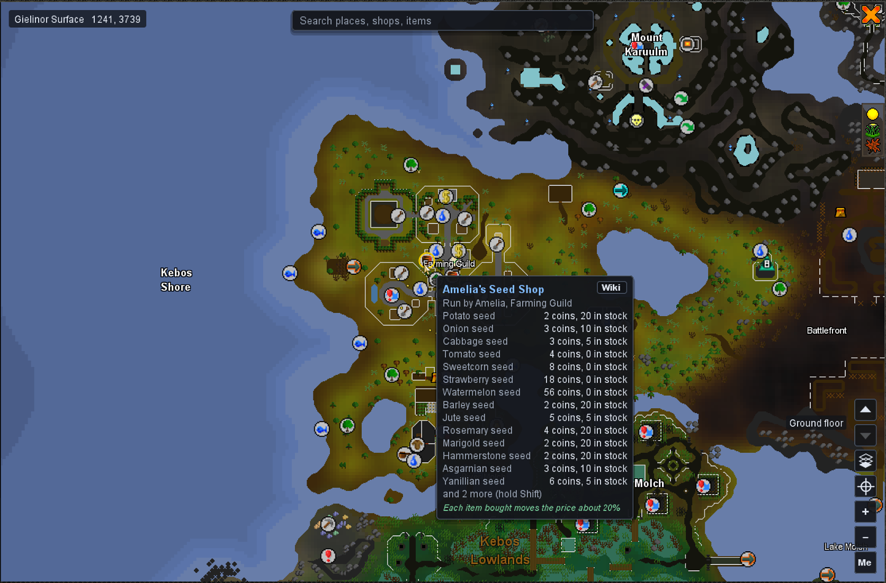
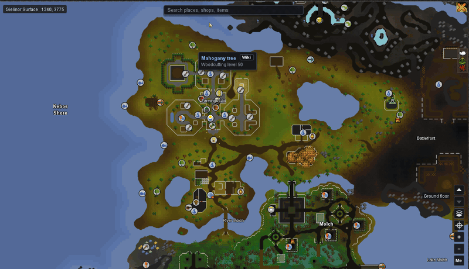
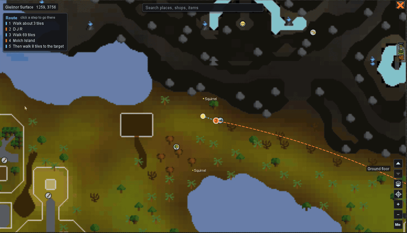
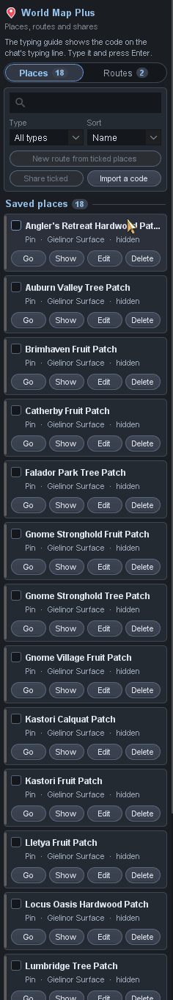
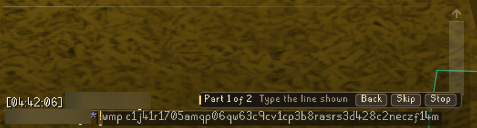
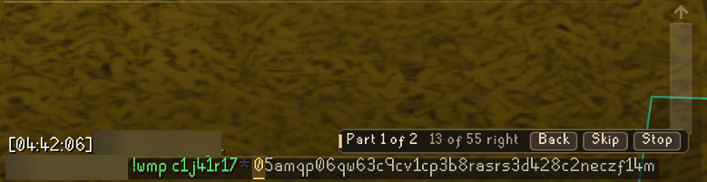
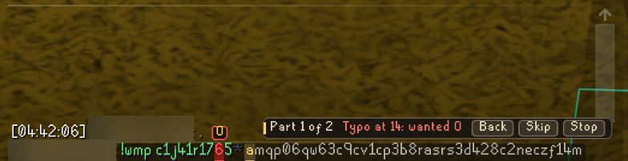
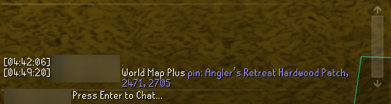
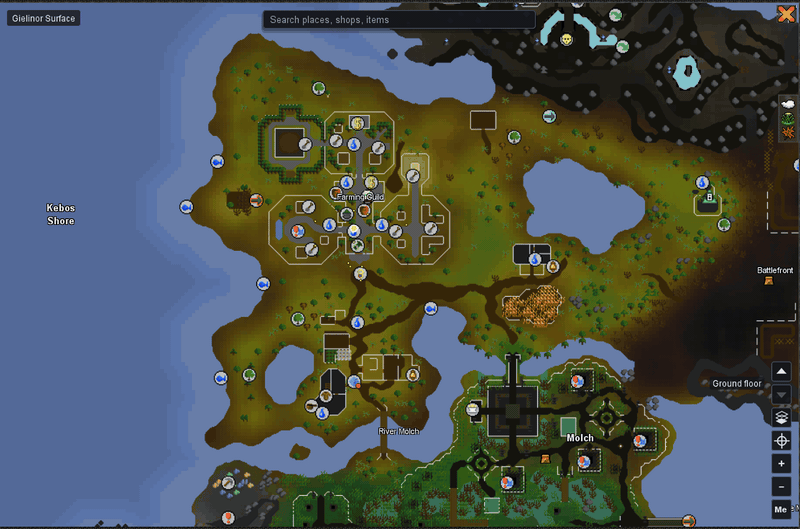

# World Map Plus

World Map Plus takes over the in-game world map and gives you a better one. You can zoom out to see the whole world or
in until a single tile is 32 pixels wide, search for almost anything, hover over icons to see what they do, plan routes,
save places and keep a see-through map on screen while you play.

Everything the map shows comes with the plugin except the detailed map pictures, which are downloaded the first time you look at
an area (see "Map pictures" below). No other connections are made.

> **Install World Map Plus Helper too.** The Plugin Hub limits how big one plugin can be, so World Map Plus comes in two
> parts. Install both from the Plugin Hub for everything on this page: sharing, the results panel and drop tables, search for
> monsters, items, shops and music, shop cards, walking lines on routes, progress marks, farming cards, wiki buttons, nearby
> NPCs and support for other plugins. World Map Plus works on its own as a map, and anything that needs the Helper says so.
> All settings stay in World Map Plus.

## Getting started

Install the plugin, log in and open the world map as usual. The new map appears over the old one. To go back to the
game's own map at any time, turn off **Replace the world map** in the plugin settings.

## Map pictures

The plugin carries a picture of the whole world for each of the surface and its three floors, so the map always shows
something. The sharp, detailed pictures are downloaded the first time you look at an area and are then kept on your
computer, in the plugin's own folder inside RuneLite's data folder. About 12 MB in all if you look at everything, in packs
of 0.1 to 0.9 MB; a pack is downloaded once and never again unless the maps are updated.

- **What is sent.** The download is a plain request for a file from this plugin's own GitHub release
  (`github.com/KingKj52/world-map-plus-maps`). GitHub sees your IP address, as for any download. Nothing about you or your
  account is sent.
- **Turn it off.** The setting **Download map pictures** (General) is on by default. Off, the map shows the overview and
  whatever was downloaded before.
- **While it downloads** a small line in the lower left corner of the map says so, and the overview shows in place of the
  pictures that have not come yet.
- **Updates.** When the maps change (a game update), a new release is made and the plugin fetches only the packs that
  changed, with no new version of the plugin needed in most cases. The files are checked against a SHA-256 before they are used.

## The map

- **Zooming.** Use the mouse wheel. It has acceleration, and it always zooms toward the
  pointer. The + and - buttons in the corner do the same.
- **Moving.** Drag the map.
- **Finding yourself.** The map opens on you and follows you as you walk. Press the **Me** button to jump back to
  your position after you have been looking elsewhere. If you are somewhere the map has no picture of, such as an
  instance, it tells you.
- **Floors.** On the surface, two arrows above the layers button move the map up and down a floor, and a label beside
  them says which one you are looking at: Ground floor, 1st floor, 2nd floor or 3rd floor. The
  ground floor shows every icon of the map, including those of the floors above at their location too (a card says which floor an
  icon is on, and its link still works). Looking at a floor above shows the icons of that floor.
- **Names and icons.** Towns, regions, seas and other areas are named on the map, with bigger names for bigger things.
  The icons are the game's own and stay about the size the game draws them (15 pixels) at every zoom, shrinking only a
  little to 11 pixels when you are far out. Where there are too many to fit, the more important kinds stay (banks,
  quests, dungeons, transport and the like) and the others come back as you zoom in. Every icon shows its name when you
  hover over it. Quest icons say which quest starts there. Clicking an entry in the
  game's own map key flashes that kind of icon on the map.
- **Dungeons and other maps.** Dungeon entrances show a small preview of the map below them. Click one to go there.
  Underground areas, Prifddinas, Zanaris, the Abyss, the Kebos and Varlamore undergrounds and many single dungeons and
  rooms all have their own maps. The map also covers minigame, raid, boss and altar areas that the game's own map leaves
  out, such as Guardians of the Rift, the three raids and the Inferno, so where you or a group member stands there is
  drawn in the right place.

## Hover cards

Hover over an icon, a doorway, a shop or a transport point and a card tells you about it.

- Dungeon entrances, ships, carts, gliders, balloons, portals, spirit trees and fairy rings say where they lead and
  what it costs.
- Teleport destinations list every way of getting there.
- Agility shortcuts give the level, the items and quests needed, how long it takes and whether it works both ways, and
  a line shows where it comes out.
- Shops list what they stock and the prices.
- Farming patches show what you last saw growing in them.
- Where the plugin has more to say about an icon, the card says it while that layer is on in the layers list: the tree
  an icon of rare trees stands for, the fish at a fishing spot, the creatures of a hunter area, the ore of a mining site,
  the name of a minigame or an agility course, the level a salvaging spot or a port asks for. The icon and its basic card
  are there whether the layer is on or not.
- Cards that end with "and more" show everything while you hold Shift.
- Cards about something that has a page on the Old School RuneScape Wiki have a small **Wiki** button in their corner:
  shops, quests, some kinds of transport and some well known places such as agility courses and minigames. After you
  point at an icon, its card stays put for a moment, so you can move the pointer onto the card and press the button. The
  page opens in your own web browser. The plugin never connects to anything itself, and it only ever opens pages of the
  Old School RuneScape Wiki. Where a name might not be a page, the button says **Search wiki** and opens the wiki's own search page.
  **Wiki buttons** in the settings turns the buttons and the menu entries off.

## Search

Click the search bar. You can find places, dungeon entrances, shops and shopkeepers, every item a shop
sells, monsters, NPCs, items on the ground, quest starts, music tracks and your own pins. Type a tile such as
`3222 3218` to jump straight to it.

Words can come in any order, and a slip of one letter in a longer word is forgiven (`varock`, `shrak`), though the exact
spelling still comes first. A plain word for a kind of place, such as `bank`, `anvil`, `herb patch` or `shark`, gives
**every place of that kind** as one result: choosing it marks all of them, draws the game's icons of that kind at every
zoom for a while, and goes to the nearest. Add a town, as in `shark catherby` or `bank varrock`, to get that kind in that
town alone. A town's name on its own does not list everything in it.

With the **World Map Plus Helper** plugin installed (it is part of World Map Plus, split in two for the Plugin Hub), the **results panel**
appears after you choose a result with several places. It sits at the left of the map and lists them: how many are at
each place ("Catherby, 2 banks", "3 here") and how far and which way each is from you. Click a row to go there. An item
has a tab for the shops that sell it, which you can sort by nearest, stock, name or price, and a tab for where it lies on
the ground; a shop row opens what that shop sells, and **Back** goes through up to twenty earlier lists. The cross closes the
panel, and **Results panel** in the settings turns it off.

With the Helper, a monster or NPC also has a **Drops** tab: what it drops (and gives when pickpocketed), how rare, how many, sorted by rarity,
value or name, with the value of each item and the coins you can expect per kill where they can be worked out. An item has a
**Dropped by** tab: every monster that drops it, how rare, and the nearest place of that monster, which a click goes to. The
tables come from the Old School RuneScape Wiki and are bundled in the Helper; the values are RuneLite's own item prices, so this
plugin makes no request for them, and an item RuneLite has no price for shows none. **Drop tables** in the settings turns the
tabs off.

Some keys would not reach a search bar on the map if another plugin used them, such as the `W`, `A`, `S` and `D` camera
keys of Key Remapping. So **Type in the chat area** is on by default, and the search opens a box in the chat area, where
every key works. Turn it off in the settings to type in the search bar on the map instead. A map in its own window
always types straight into its own bar.

Use `Up`, `Down`, `Enter` and `Escape` in the results. In the chat area, `Enter` goes to the first
result and `Escape` closes the box, and you click the other results. Click a result to go to it. Some results have several places,
such as every spirit tree patch. Click the same result again to move to the next nearest place. The map labels the one
you are on, for example "Spirit tree patch (2 of 5)". Right-click a result to save it or route to it, or to open its wiki page.

You can narrow a search with filters. They combine, so `loc:nearby type:melee_weapon cost:500 sword` finds swords
within 500 coins near you.

| Filter | What it does |
| --- | --- |
| `region:"kebos lowlands"` | Only inside an area. `in:`, `area:`, `at:`, `where:` and `place:` work too. Part of a name is enough, and `Tab` autocompletes it |
| `map:keldagrim` | Only on a map with that in its name |
| `type:shop` | Only one kind of result: place, shop, npc, monster, item, quest, transport, teleport, entrance, point, music, tile or pin. Item kinds such as `melee_weapon` work too, and `type:shop,npc` takes either |
| `type:place` | Named places such as towns, inns, castles and dungeons. These only appear when you ask for them |
| `name:"iron arrow"` | The words must be in the name itself |
| `cost:500` | Items that cost that much or less. Also `cost:<500`, `cost:>100` and `cost:100-500` |
| `free:yes` | Items that lie on the ground for free |
| `loc:nearby` | Close to you. `dist:40` sets how many tiles |
| `sort:cost` | Cheapest first. Also `sort:dist` and `sort:name` |
| `-region:varrock` | A dash leaves things out. It works with `region`, `map` and `type` |

## Routes

Right-click anywhere and choose **Route here**. If you have the Shortest Path plugin, it works out the route, and the
map draws it: numbered markers for the boats, teleports and shortcuts, a line for the walking in between (along the walkable
tiles with the World Map Plus Helper, straight without it), and a list of the steps. Click a step to jump to where it starts.

Once a route exists, the menu also offers **Set route start here**, to route from a tile you pick instead of from where
you stand, and **Add route target 2 here** (and 3, and so on) to head for whichever target is nearest. **Clear route**
removes it. Routes that other plugins ask for, such as a Quest Helper step or a group member in the Group Ironmen
companion, are drawn too.

## Pins, saved places and your own routes

Right-click to add a pin, or to save a shop, a person or a search result. Everything you save appears in the side panel,
where you can filter, sort, rename, recolour, resize, hide and delete it, and route to any of it with a click.

You can also build routes of your own. Tick several saved places, put them in order, decide whether the route loops, and
press **Start**. The plugin asks Shortest Path for one stop at a time and moves on when you arrive. **Skip** jumps to
the next stop. Routes still pass through hidden pins. Each route in the side panel lists its stops by number, the first
three and "+12 more", which shows them all.

**Order** on a route of three to twelve stops puts them in the shortest order. You choose whether the first stop stays
first and whether the route comes back to it at the end. The lengths are the walks the World Map Plus Helper finds between stops on the
same map and floor, and the straight line elsewhere (teleports are not counted). The side panel says the length before and
after, and **Undo order** puts the stops back as they were.

## Sharing

Sharing is in a second Plugin Hub plugin, **World Map Plus Helper**, which needs this one. Install it for everything in this
section: the buttons below stay in this plugin's side panel, and without the Helper they say it is missing. The settings stay
in this plugin's settings, under Sharing, and say "Needs World Map Plus Helper". Codes made before the split still work.

**Share ticked** in the places tab (one ticked place makes a pin code, more make a set of places) and **Share** on a
route show a short chat command, such as `!wmp p10kgkm86a` for a pin at the Farming Guild. Type it into the game's chat
yourself and send it. The panel shows the whole of each message in fixed width letters, in groups of four that wrap to 
the side bar, with its length, its state (not typed, typing, done) and what it holds, so you can check it, and a 
**Copy** button that copies the exact message for use outside the game. A pin is 15 characters, a route of five stops in 
a town about 30. A long route is split into up to eight messages (`!wmp c1...`), numbered, which can be sent in any order.

**Typing guide.** Share also puts the first message on the chat's typing line as see-through letters, where your own
letters appear. As you type, each right letter turns green and a wrong one red, with the letter that was meant in a small
tag above it; the next letter is picked out in gold. The see-through letters start just after the game's own cursor. 
A small card above the line says which part you are on ("Part 2 of 3"), how far you are or where the first typo is, and 
"Matches, checksum ok" when the line is exactly right, with **Back**, **Skip** and **Stop**. When you send a whole part 
the guide moves on to the next one by itself, and after the last it goes away. Case does not matter, and a channel prefix 
such as `///` before the code is allowed. The side panel has the same controls and a **Type it** button on each message. 
If the letters do not sit exactly on yours, set **Typing guide position** to **Just above the typing line**, which 
shows the whole message in a strip above it; turn **Typing guide** off to leave the chat line alone.

Only places travel: the tile, the floor and, when the tile alone does not say it, the map. Names, colours, sizes and
paths do not. A route keeps the order of its stops, and the way between them is worked out by Shortest Path with your
own settings and unlocks. Codes need no server and work offline; the format is in `docs/SHARE-PROTOCOL.md` of the source.

Players who also have the plugin see what a code holds in place of the code, the way `!lvl` shows a level: "World Map
Plus pin: 1249, 3720", "World Map Plus route: 15 stops, starts at 1000, 2100" or "World Map Plus places: 4" (a place is
named only when you have saved a place at that very spot, or it is on a map other than the surface). They can right
click the line and choose **Open in World Map Plus**: the share is marked on the map and listed under **Shared with you**
in the side panel with **Show**, **Go** (Shortest Path to the first stop), **Save** and **Dismiss**. A code in several
messages shows "World Map Plus route, part 1 of 2 received, waiting for the next part" until the last part arrives; then
every one of its lines shows the whole route, and a right click on any of them opens it. The game offers no right click 
entries on your own lines, so **Open in World Map Plus** is only on other players' lines; your own route is in your side
panel. Nothing is saved until you press **Save**. If you would rather chat were left exactly as it is, turn off **Show
share codes in chat**.

**Codes outside the game.** **Copy whole code** in the share box copies the whole code as one, however long (no chat
limit applies in Discord or a forum post), and **Copy all parts** copies a long code's messages one a line, each with
`!wmp`, for someone who types them into game chat one by one. **Import a code** in the places tab opens a box to paste
into: a code with or without `!wmp`, among other words, in quotes or code blocks, in any case; a long code as one; or its
parts, on separate lines, on one line, run together, in any order, or one paste at a time ("Part 1 of 2 added, paste the
next part"). Every share read is listed under Shared with you, and nothing is saved until you press Save. A code that
does not read says why, such as "Checksum mismatch near character 11, check what you typed". **Import clipboard** reads
what is on the clipboard the same way.

## Your progress

Four settings, all off until you turn them on, let the map respond to your levels, quests, achievement diaries and quest
points. They are in the **Your progress** section of the settings.

- **Hide quests you have finished.** The icon where a quest starts goes away once you have finished that quest, and the
  quest no longer comes up in a search.
- **Mark what you cannot use yet.** An icon that needs a level, a quest, an achievement diary tier or quest points you do
  not have is drawn faded, with a small padlock in its corner, and its card has a "Missing" line that says what, such as
  50 Agility or Hard Ardougne Diary. A search result for such a place says the same in gold under its name.
- **Only show what you can use.** The icons that would be marked are left off the map instead.
- **Colour quest icons by progress.** The icon where a quest starts carries a small dot: red when you have not started the
  quest, yellow when you have, green when it is finished.

The map only judges what it is sure of. It reads your real levels, your combat level and your total level (the max cape
teleports ask for every skill at 99), so a boost can get you past a marked icon. A quest you have started but not finished
is not held against you. It reads which achievement diary tiers you have done and your quest points while one of the two
settings that judge is on. Anything the map has no information about counts as usable, and items and the like are
never checked: they stay as text on the card. The marks cover agility shortcuts, boats, carts, gliders, fairy rings,
spirit trees, balloons and the other transport stops, rare trees, salvaging spots and ports, agility courses, minigames,
some dungeon entrances and farming patches (where the wiki states a level, a quest or quest points for them), and the
cards of teleport destinations, including the teleports of diary rewards such as the Ardougne cloak.

## Layers

The layers button opens a list of things you can switch on and off.

- Nearby NPCs, with names when you are zoomed in
- Cards on icons, doorways, transports and shops
- Area names
- Wilderness levels
- A grid of the game's regions with their numbers
- A trail showing where you have walked this session
- Region borders and names
- Pins and saved places
- Points of interest: agility courses, minigames, runecrafting altars, mining, fishing, hunter areas, farming patches,
  rare trees, salvaging spots, ports and teleport destinations. Where the game already draws an icon, these add their
  details to the icon's card, and are not drawn a second time. Where the game draws nothing (runecrafting altars,
  teleport destinations, and the few places the game leaves out) they are drawn as before.
- Icons of the game's map: every kind of icon the plugin draws (banks, quests, water sources, cooking ranges and the
  rest) has a tick box, so any kind can be hidden.

The list sits beside the buttons and never covers them or goes outside the map, even on the smallest floating map. When
it is taller than the room it scrolls: use the mouse wheel over it, or drag the bar down its edge. Names too long for a row
are cut short, and the whole name shows while the pointer is on it. Close it with the layers button, the cross in its
corner, `Escape`, or a click on the map. The right click menu and the cards behave the same way on a small map.

The trail for where you've been can fade as it gets older. Set **Trail fades after** to a number of tens of tiles: 1 fades it out over the last
10 tiles you walked, 2 over 20, 2.1 over 21, and so on. 0 never fades it.

## Floating map

Press `Ctrl+M` to show a see-through map over the game. It sits under the game's own panels, so the inventory, chat and
minimap always stay on top. Press `Ctrl+Shift+M`, or use the **Click-through** setting, to choose between a map the
mouse passes straight through and one you can drag, zoom and search. Size, corner, opacity and opening zoom are in the
settings. The floating map is never made smaller than 180 by 150 pixels, so its buttons and the lists that open beside
them always fit. On a map too short for one column the buttons stack in two.

The keys of this plugin leave the game's typing alone. While you are typing a chat message, have a box open with the
cursor in it (a bank or Grand Exchange search, an amount), or the chat area is asking for something, **Show or hide**,
**Click-through hotkey** and `Ctrl+F` do nothing, and a letter you bound to one of them still types. While a dialog or a
window that takes keys itself is open, a key you bound to a letter or a number is left for it, and keys held with `Ctrl`
or `Alt` still work.

## Extra windows

Middle-click a link to another map, a search result or a step of a route to open that place in a window of its own. Each
window has its own view, search and menu, and you can have up to six open next to the game.

## Other plugins

Support for other plugins is in **World Map Plus Helper**, the second Plugin Hub plugin (it needs this one, and this one
works without it). With both installed, plugins that put things on the world map keep working; without the Helper this
map shows what the game's own map shows of them and nothing else. The settings for it stay in this plugin's settings and say
"Needs World Map Plus Helper". Points they add, such as the golems from Golems Don't Die, show
on this map too, and so do the other members of your party from RuneLite's own Party plugin, with their names. The layers list names 
each plugin that has points on the map and lets you hide any of them.

Right-click a party member and choose **Follow** to keep the map on them as they move, onto another map too if they go
underground. Dragging the map, searching, or **Locate me** stops it, and so does the member leaving the party or going
somewhere this map has no picture of. Following only reads the point the Party plugin puts on the game's map.

A point on the game's map that jumps somewhere when clicked has **Focus on** in this map's right click menu, as it does
on the game's map. Plugin authors can add markers, lines, menu entries and layers of their own through a small set of
plugin messages, described in `docs/COMPAT.md` ("Plugin API v1"), with a one file helper in `docs/api`. Version 3 of the
same messages (side panel sections, painters on the map, hover card lines, search results, menu entries, saved places) is what a
second plugin can use to add parts of the interface; it is described in the same file ("Plugin API v3"), with its own helper.

Some plugins only fill in the area around where the game's own map is looking. So that they still work here, the game's
map is moved to the middle of what you are looking at whenever you stop moving this map, even though the two are zoomed
differently. It starts once any other plugin has put a point on the game's map, and until then the game's map is left
alone. Turn off **Keep the game map with this one** to stop it.

A few plugins, Quest Helper among them, draw their own lines straight onto the game's map. To see those lines here,
press the **line up** button (the ring with a cross above the zoom buttons) or turn on **Line up with the game map**.
Line up is for exact lines: the map then moves and zooms with the game's own, so you use the wheel and drag as usual, and
the lines fall in the right place. In this mode hold `Ctrl` and right-click to open this map's menu, because a plain right-click opens the game's.

## Mouse and keys

| To do this | Do this |
| --- | --- |
| Move | Drag |
| Zoom | Wheel, or the + and - buttons |
| Jump to yourself | The **Me** button |
| Change floor | The arrows above the layers button |
| Search | Click the bar |
| Open a dungeon map | Click its entrance |
| Open a place in its own window | Middle-click a link, a search result or a step |
| See a whole card | Hold `Shift` on it |
| Menu | Right-click. It has **Open wiki page** for things that have one |
| Save, route to or open the wiki page of a search result | Right-click it |
| Open a card's wiki page | Move onto the card within a moment of leaving the icon, then press **Wiki** |
| Floating map | `Ctrl+M` shows or hides it, `Ctrl+Shift+M` switches click-through |

## Settings

| Section | What it covers |
| --- | --- |
| General | **Replace the world map**, **Follow other plugins**, **Show other plugins' points** and **routes**, **Wiki buttons**, **Results panel**, **Drop tables**, **Show share codes in chat**, **Replace my own share lines too** (on by default), **Typing guide** (on by default) and **Typing guide position** (over the typing line by default, or just above it), **Keep the game map with this one**, **Line up with the game map**, **Open at** (where you are or where you last looked), **Follow me**, **Show coordinates**, **Smooth close-up** (blends pixels when you zoom in past the map's native detail, off keeps the crisp pixel look), **Type in the chat area** (the search opens in the chat area, where keys that other plugins take still work; on by default, turn it off to type in the bar on the map) |
| Zoom | **Zoom speed**, **Zoom acceleration**, **Zoom smoothing** |
| Map layers | **Cards on map icons, doorways, transports and shops**, **Area names**, **Pins and saved places**, **Wilderness levels**, **Region grid and ids**, **Where I have been** and **Trail fades after**, **Region borders**. The layers button on the map changes the same settings |
| Floating map | **Enable floating map**, **Show or hide** and **Click-through hotkey**, **Click-through (mouse passes through)**, **Opacity**, **Size**, **Position**, **Opening zoom** |
| Nearby NPCs | **Show nearby NPCs**, **Show from zoom**, **Radius**, **Filter**, **Show names**, **Names from zoom** |
| Your progress | **Hide quests you have finished**, **Mark what you cannot use yet**, **Only show what you can use**, **Colour quest icons by progress** |
| Look and feel | **Theme** (Bronze by default, or Slate, Parchment and High contrast), **Animations** (on by default), **Sounds** (off by default) |

## Good to know

- Walking lines between jumps are worked out by this plugin, so where two ways are equally short it may pick a
  different one from Shortest Path. Shortest Path's own line in the game view is the one to follow.
- Floors above the ground are only available on the surface. Dungeons and other maps have a single floor, and show all their icons on it.
- Farming cards show what you last saw, so a patch you have never walked past says so.
- Not every NPC has a known spawn, and some quests do not have a start position yet.
- When getting data from the wiki, a hard limit of only a couple queries/minute over the course of many hours to lighten the load as much as possible.

## Credits

The map pictures and much of the shop, monster and quest information come from the Old School RuneScape Wiki. Transport,
teleport and walking data come from the Shortest Path plugin by Skretzo, and several lists from RuneLite. This plugin is
not affiliated with or endorsed by Jagex, the Wiki or the authors of the plugins it works with. Full credits are in
[NOTICE](NOTICE).

Created using intellectual property belonging to Jagex Limited under the terms of Jagex's Fan Content Policy.
This content is not endorsed by or affiliated with Jagex.
